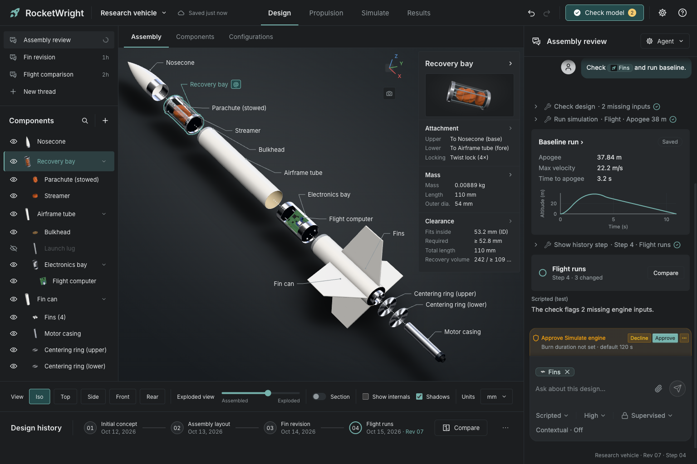
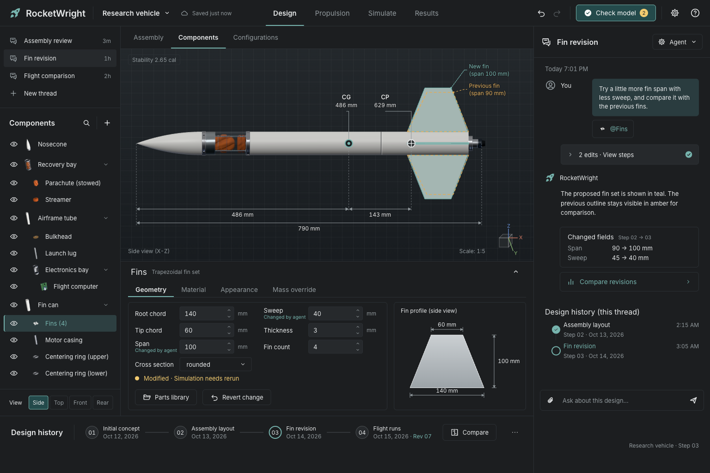
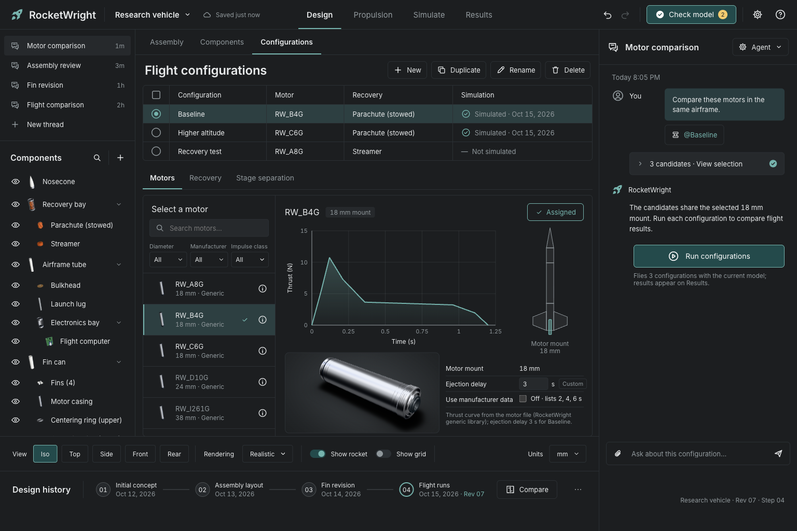
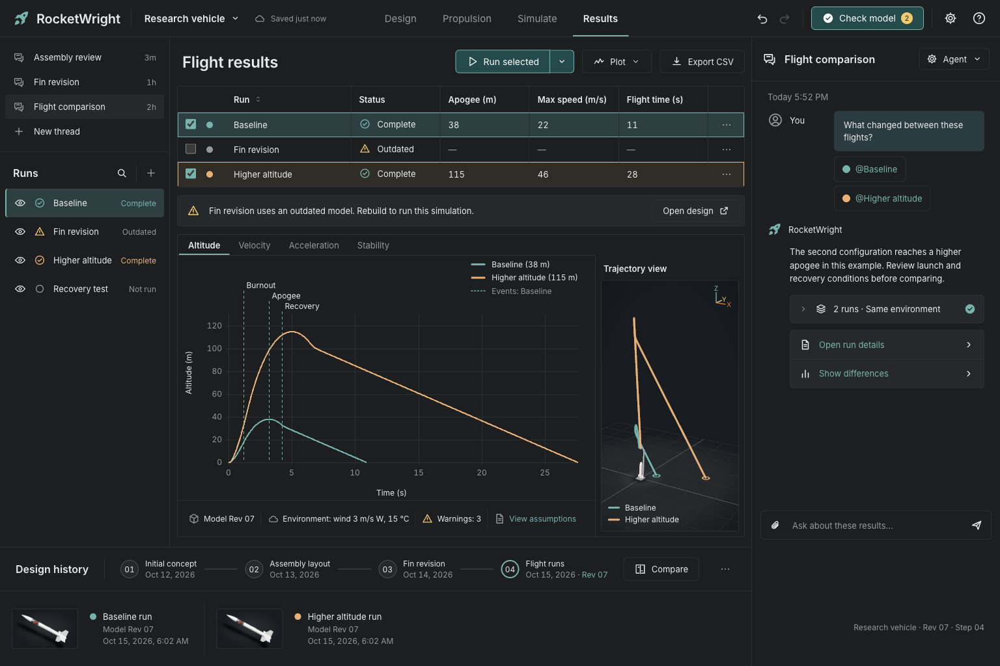
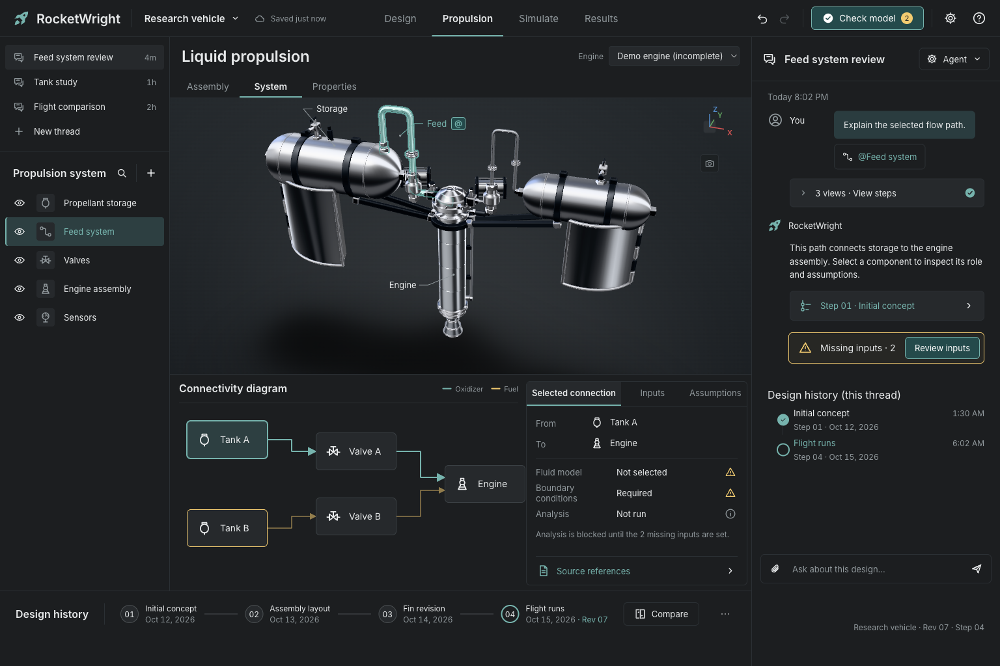
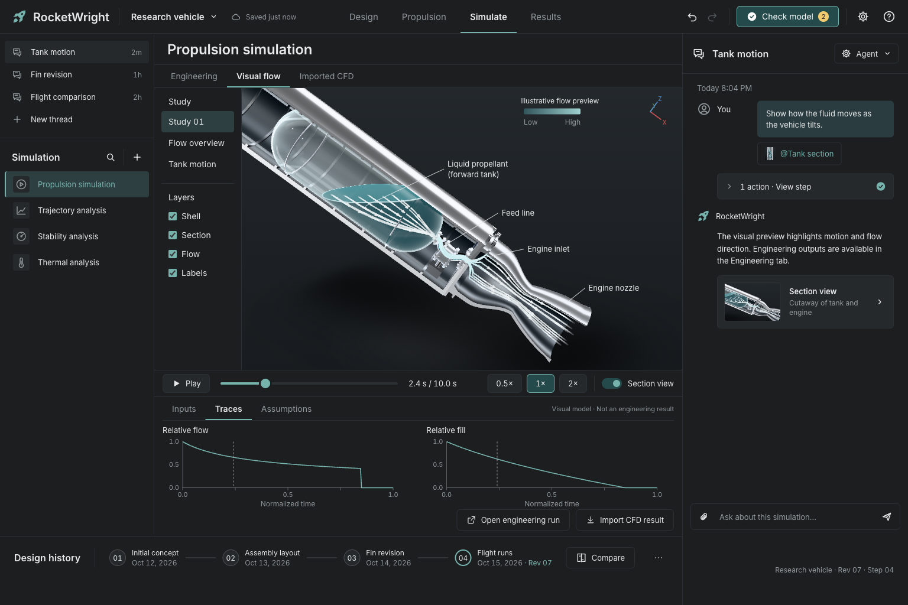

# RocketWright

> [!WARNING]
> **Alpha.** RocketWright is early software: expect rough edges, breaking changes to project files and commands, and results you should check against another tool before you fly. Desktop builds are unsigned.



Agent-driven rocket design and simulation for hobbyists. You describe a rocket
in a chat (or in plain TOML files), and an agent edits the design, checks it,
flies it, and renders it, with every number coming from the engine rather than
the model's arithmetic.

- **Design and check**: a parametric model (`rocket.rw.toml`, expressions,
  named anchors), mass and CG, Barrowman-style aerodynamics with stability
  margin, clearance and recovery rules, stable diagnostic codes.
- **Flight simulation**: rail, 3DOF, and 6DOF rigid-body flight with variable
  mass, recovery events, wind, a built-in generic motor library that works
  offline, and run caching with provenance.
- **Liquid engines**: chamber, nozzle, and injector sizing, feed budget and
  tank blowdown from shipped NASA CEA tables, or native CEA for any CEA
  species (for example `"N2O(L)"`/`"IPA(L)"`).
- **Front ends**: the `rocketwright` CLI (also `rw`), a stdio MCP server, a
  WASM build of the core, and an Electron desktop app with an embedded
  [Lecturn](https://github.com/Nurozen/lecturn) agent pane, a 3D viewport,
  and run comparison.
- **OpenRocket interop**: `rw import ork` and `rw export ork`.

## Screenshots

Frames from the app, captured by its visual test harness on the bundled sample
project. The agent pane in these five predates the embedded Lecturn pane shown
above.

| | |
|---|---|
|  |  |
| **Design.** Edit a part and compare it with the previous revision; CG, CP and stability update as you go. | **Configurations.** Pair the airframe with motors from the built-in offline library. |
|  |  |
| **Results.** Overlay runs, inspect events, and see each trajectory in 3D. | **Liquid propulsion.** Lay out tanks, valves and the engine, and see which inputs an analysis still needs. |
|  | |
| **Flow preview.** An illustrative cutaway of propellant moving through the tank and feed line (a visual model, not an engineering result). | |

## Status

Alpha, macOS-first (Apple Silicon). The core, CLI, MCP server, desktop
app, and liquid-engine tools work end to end and are covered by `make check`.
Known gaps: OpenRocket parity holds on the seven reference cases, but the
rail-button drag model rests on an assumed boundary-layer profile
([`docs/dev/parity-log.md`](docs/dev/parity-log.md)); release builds of the desktop app are unsigned until the
signing secrets are configured ([`docs/dev/releasing.md`](docs/dev/releasing.md));
and there is no Monte Carlo (a non-goal: every simulation is one deterministic
flight).

## Prerequisites

See [`docs/dev/environment.md`](docs/dev/environment.md) for exact versions.
`make env-check` checks every item and prints the fix for each failure.

- Rust via [rustup](https://rustup.rs) (the toolchain is pinned by
  `rust-toolchain.toml`, with the `wasm32-unknown-unknown` target). Homebrew's
  `cargo` shadows rustup's, so put `~/.cargo/bin` first on `PATH`.
- `wasm-bindgen-cli` 0.2.129, equal to the crate pin:
  `cargo install wasm-bindgen-cli --version 0.2.129 --locked`
- Node 24 and pnpm 12 (`corepack enable && corepack prepare pnpm@12 --activate`)
- [Vite+](https://viteplus.dev) (`vp`), which builds the embedded Lecturn
  agent pane: `curl -fsSL https://vite.plus | bash`, then open a new shell
- A [Lecturn](https://github.com/Nurozen/lecturn) checkout beside this repo
  (the setup below clones it to `../lecturn`; `LECTURN_REPO=<dir>` points
  elsewhere). The app embeds Lecturn from tarballs built from the commit in
  `vendor/lecturn/PIN`
- Optional: gfortran and cmake for native NASA CEA (`brew install gcc cmake`);
  needed by `make check` and `make kit`, not by `make check-fast` or `make dev`
- For the app's agent: a logged-in provider CLI (for example `claude` or
  `codex`). The embedded Lecturn pane runs it and stores no keys; pick the
  provider in the pane's Settings

## Setup

```sh
git clone https://github.com/Nurozen/RocketWright.git rocketwright
cd rocketwright
git clone https://github.com/Nurozen/lecturn ../lecturn
export PATH="$HOME/.cargo/bin:$PATH"
make env-check
make vendor-lecturn                         # build the pinned Lecturn into vendor/lecturn/
(cd app && pnpm install --frozen-lockfile)
make check-fast        # Rust, schema drift, WASM, TS typecheck/lint/tests
```

`app/package.json` depends on the Lecturn tarballs in `vendor/lecturn/`, which
are not committed, so `pnpm install` fails until `make vendor-lecturn` has run.
That target builds the pinned commit in a temporary worktree of `../lecturn`
(removed afterwards), smoke-tests the result under Node and Electron
(downloading the pinned Electron on first use), writes the tarballs, and
installs `app/`. It takes several minutes the first time and is a no-op until
`vendor/lecturn/PIN` changes.

`make check` is the full gate: it adds the native CEA tests and the
Playwright/Electron e2e specs, and needs a logged-in GUI session.

## Run the desktop app

```sh
make dev                    # a fresh /tmp copy of fixtures/research-vehicle
make dev PROJECT=~/my-rocket # open your own project in place
make dev BROWSER=1 OPEN=1   # serve the app to a browser instead of Electron
```

`make dev` builds the plain sidecar (`target/rw-plain/rocketwright`, never
the test-only `doubles` build), the WASM core, and the web bundle, then starts
Electron.

## CLI quick start

Build the CLI and put it on `PATH` as both names:

```sh
cargo build --release -p rw-cli          # add --features cea for native CEA
ln -sf "$PWD/target/release/rocketwright" ~/.local/bin/rocketwright
ln -sf "$PWD/target/release/rocketwright" ~/.local/bin/rw
```

Then, in an empty directory:

```sh
rw init --template simple-rocket
rw check --strict
rw set params.fin_span.value="50 mm"
rw render --view profile
rw sim baseline
rw run summary baseline --fields apogee,max_velocity,time_to_apogee
```

Units are mandatory (`"54 mm"`), expressions start with `=`, and every write
is recorded as a history step in `.rw/` (never in your git repository).
`rw --help` lists every command. The full model and command reference is
[`docs/agents/rocketwright-model.md`](docs/agents/rocketwright-model.md).

## Use it from your own agent

`docs/agents/` is a Claude Code skill. With `rw` on `PATH`:

```sh
ln -s "$PWD/docs/agents" ~/.claude/skills/rocketwright          # for you
ln -s "$PWD/docs/agents" <project>/.claude/skills/rocketwright  # for one project
```

Claude Code loads [`SKILL.md`](docs/agents/SKILL.md) and reads the model
briefing and [`diagnostics.md`](docs/agents/diagnostics.md) on demand. Any MCP
client can use `rocketwright mcp --project <dir>` instead.

## Maintainer-only targets

Some targets read inputs that are not in this repository:

- `make kit` writes a self-contained `dist/kit/` (the release CLI with native
  CEA, its CEA databases, the headless 3D renderer app, the agent docs,
  example data, and `LICENSE`, `NOTICE.md`, and `LICENSES/`) and ends by
  designing a custom N2O(L)/IPA(L) engine with the kit binary.
- `make parity` imports OpenRocket's example rockets with `rw import ork` and
  checks them.

Both read `.ork` example files from an
[OpenRocket](https://github.com/openrocket/openrocket) checkout
(GPL-3.0-or-later; `RW_OPENROCKET` or `RW_ORK_EXAMPLES`, default
`../openrocket`), and `make kit` also needs the cached variant in the
gitignored `tests/oracle/cache/`, which the maintainers' OpenRocket oracle
harness regenerates. `.ork` files are read as data and are never committed.
The `make bar*` targets compare against reference images and run records kept
outside the repository; see [`docs/dev/bar-tooling.md`](docs/dev/bar-tooling.md).

## Clean-room policy

RocketWright is implemented from published sources (NACA and NASA reports,
theses, papers; see [`docs/dev/citations.toml`](docs/dev/citations.toml)).
OpenRocket runs as the reference oracle whose exported numbers are the parity
goldens. Its sources, like those of openMotor and JSBSim, may be read to
understand an approach, but RocketWright re-implements from the theory and
never copies or translates GPL or LGPL code. Code from MIT, BSD, or Apache-2.0
projects (RocketPy, NASA CEA, Lecturn) may be reused with attribution in
[`NOTICE.md`](NOTICE.md). `cargo xtask audit`, part of every gate, enforces
this: denylisted names, uncited physics functions, unattributed ports, and
committed `.ork` files all fail it. Procedure and roles:
[`docs/dev/clean-room.md`](docs/dev/clean-room.md).

## Documentation

- [`CONTRIBUTING.md`](CONTRIBUTING.md), [`AGENTS.md`](AGENTS.md): how to contribute, conventions for coding agents
- [`docs/agents/`](docs/agents/): the agent briefing, skill, and diagnostic codes
- [`docs/dev/environment.md`](docs/dev/environment.md): toolchain, setup, make targets, pitfalls
- [`docs/dev/releasing.md`](docs/dev/releasing.md): CI, cutting a release, signing, the packaged app
- [`docs/dev/project-session.md`](docs/dev/project-session.md): the session, single writer, history
- [`docs/dev/metric-paths.md`](docs/dev/metric-paths.md): field paths for deltas, asserts, reports
- [`docs/dev/parity-log.md`](docs/dev/parity-log.md): OpenRocket parity results
- [`docs/dev/clean-room.md`](docs/dev/clean-room.md): clean-room rules and audit
- [`docs/dev/wasm.md`](docs/dev/wasm.md), [`docs/dev/spikes.md`](docs/dev/spikes.md): WASM build, risk spikes
- [`NOTICE.md`](NOTICE.md): third-party code and data

## Third-party code

See [`NOTICE.md`](NOTICE.md) for the third-party code and data RocketWright
reuses or ships, with licenses. The vendored NASA CEA source under
`third_party/cea/` is Apache-2.0.

## License

Copyright (C) 2026 Cloud Gatherer Labs LLC. RocketWright is licensed under the
GNU Affero General Public License v3.0 or later (AGPL-3.0-or-later); see
[`LICENSE`](LICENSE). Third-party code and data
keep their own licenses, listed in [`NOTICE.md`](NOTICE.md). Report security
issues as described in [`SECURITY.md`](SECURITY.md).
