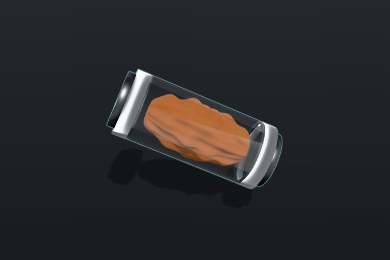
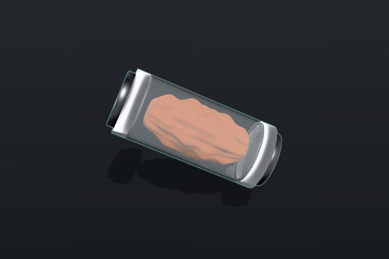
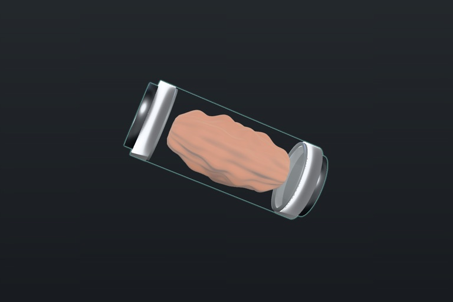
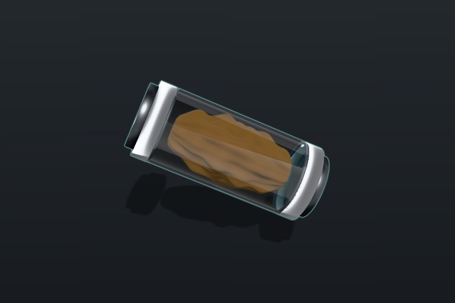
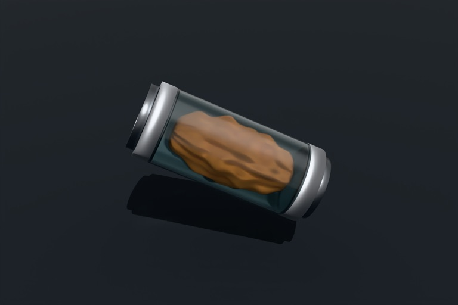
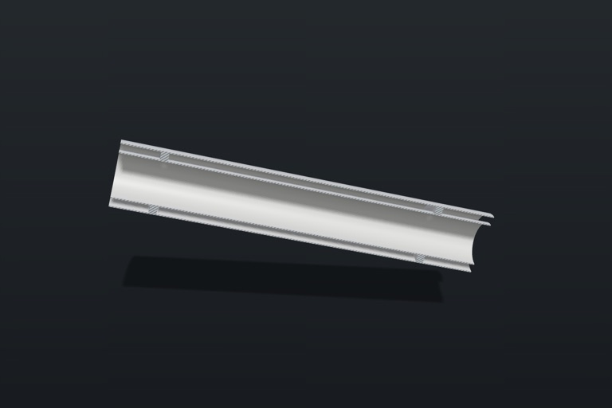
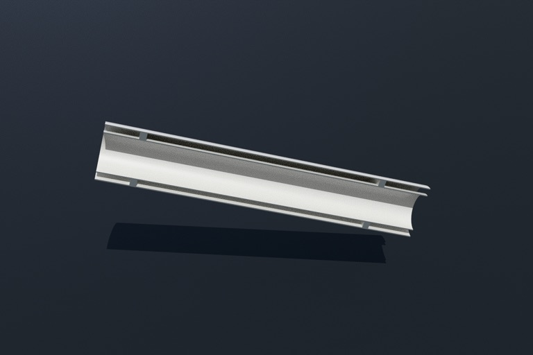
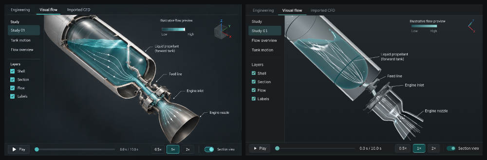
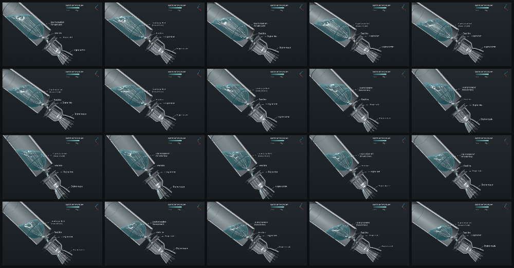

# Spikes

## RL3: headless 3D renders through `rocketwright-render` (kept)

Path: `rw render --view iso|top|side|front|rear` → `crates/rw-cli/src/render3d.rs`
builds the IF8 `RenderRequest` (evaluated model + check, size default
1536×1024, `scheme` default `check`) → locates the renderer (`$RW_RENDER` →
`<bin>/rocketwright-render` → `<bin>/../Resources/bin/` →
`{,~}/Applications/RocketWright.app/Contents/Resources/bin/`; none → exit 2 and a
hint) → JSON on stdin → `bin/rocketwright-render` (sh: the checkout's
Electron, `env -u ELECTRON_RUN_AS_NODE`) → `apps/desktop/src/render-main.ts`
serves `apps/web/dist` on 127.0.0.1, opens a hidden DPR-1 window on
`?mode=render&job=1`, calls `window.__rwRunJob(request)`
(`apps/web/src/render/job.ts`: rw-wasm `mesh_glb` → `AssemblyModel` → flat check
materials (`render/recipes.ts`: matte grey, amber/red by the worst diagnostic on
the component) → orthographic preset framing → `WebGPURenderer` with
`NeutralToneMapping`, sRGB output → `canvas.toDataURL` in the same task as the
render) → one reply JSON line on stdout (`png_base64`, backend, adapter, body-frame
camera, timings). The session writes the PNG and `renders/manifest.json`; the
renderer writes nothing (I1).

Gates: `cargo test -p rw-cli --test render3d` (stand-in renderers: request valid
against `schema/render-request.json`, manifest, WebGL2/fallback → exit 2, absent →
exit 2; `RW_GPU_TESTS=1` adds a real < 5 s tube render) and
`app/apps/desktop/src/render3d.gpu.test.ts` (`make test-gpu`): tube iso via the
CLI < 5 s on WebGPU, all five presets, and colour agreement of the exported PNG
with a CDP capture of the same window over flat 6×6 patches.

Measured (apple / metal-3, debug `rocketwright`): renderer job ≈ 0.4 s
(page ready 0.3 s, mesh 25 ms, render+readback 60 ms), `rw render` wall 0.9-1.3 s
idle and up to 3 s at load average 50; colour agreement worst ΔE2000 0.98
(81 model and 3917 background patches).

Notes:

- `process.stdout.write` to a pipe is asynchronous and `app.exit` does not wait,
  so the reply resolves on the write callback before exiting (otherwise the
  reply is lost and `rw` reports "exited without a reply").
- The clear colour also goes through tone mapping: white clears to about
  `#f0f0f0`. Masks should key on the corner pixel, not on pure white.
- The checkout's Electron binary comes from the `electron` postinstall; a fresh
  worktree whose `pnpm install` skipped it needs `node install.js` in
  `node_modules/.pnpm/electron@44.8.0/node_modules/electron` (the launcher
  prints a JSON error when `path.txt` is missing).
- `exploded` and `section` (M3.5) are renderer views: Iso framing,
  `exploded` defaults `--explode` to 1, `section` cuts with `manifold-3d`
  (below). `--compare` landed with M2.7.

## RL1 (M1.13a-c): visual feasibility (kept as spikes)

Path: `app/apps/web/spikes/{transmission,pathtrace,section}.html` (separate Vite
entries, so the app bundle never loads the path tracer or manifold-3d), shared
scene and probe in `spikes/common.ts`, reusable pieces in
`app/apps/web/src/render/{section,pathtrace,metrics}.ts`. Capture:

```sh
pnpm --filter @rw/web build        # or pass --build
node app/e2e/capture/run.ts --url spikes/transmission[?glass=blend|oit&inner=…&dw=0&ao=0]
node app/e2e/capture/run.ts --url spikes/pathtrace [--oidn-weights rt_hdr_alb_nrm_small.tza]
node app/e2e/capture/run.ts --url spikes/section[?pt=1]
```

`run.ts` drives the desktop hidden-window capture (`apps/desktop/src/main.ts
--render-out`, new `--page-path spikes/<x>.html`), real WebGPU at DPR 1 and
1536x1024, waits for `window.__rwSpike`, checks the probe plus the captured
PNG (the final tone-mapped output), and prints `GO`/`NO-GO` (exit 0/1). Output:
`dist/spikes/<name>.{png,json,report.json}`. Measured on Apple M4 (apple /
metal-3, not a fallback adapter), Electron 44.8.0 / Chrome 152, three 0.186.1.
Every capture below logged zero WebGPU validation or shader errors.

| Spike | Verdict | Measured |
|---|---|---|
| (a) clear recovery bay + orange chute, studio env, GTAO, 2 px teal Outline | **GO** with `MeshPhysicalNodeMaterial.transmission` | chute orange through glass 0.51 of its core box; outline median width 2 px, 3205 teal px; GTAO darkens 84k px by 2.8 levels; 60 fps (rAF cap) |
| (a') glass-in-glass (clear liner inside the clear bay) | **GO with a rule**: both layers transmission, outer `depthWrite=false` | chute 0.37; blended or OIT layers wash the chute out (0.00) |
| (a'') blended glass / `OITPassNode` | **NO-GO** for clear parts over saturated contents | chute desaturated to #d19c87 (fails); OIT also drops the transparent shadow catcher and the glass reflections |
| (b) `three-gpu-pathtracer/webgpu` 0.0.27, 64 spp | **GO** as an opt-in still (never bar evidence, D26) | 64 spp min in 20-24 s (3.2 spp/s at 1.57 MP); noise 1.94 |
| (b') + OIDN (`oidn-web` 0.5.0, `rt_hdr_alb_nrm_small`) | **GO**, optional | denoise 0.6-3 s; noise 1.94 to 0.20 |
| (c) `manifold-3d` 3.5.4 section cut with caps | **GO** | F:82 tube 49871.1 / 24935.6 exactly; cut mesh volume = manifold volume; caps 600.0 mm²; tube + motor mount cut in 35 ms; the cut also path-traces (32 spp in 9 s) |

Screenshots (downscaled from the 1536x1024 captures):

| | |
|---|---|
|  (a) transmission, GTAO, outline |  (a'') blended glass |
|  (a'') OIT |  (a') liner, outer `depthWrite=false` |
|  (b) 64 spp |  (b') 64 spp + OIDN |
|  (c) raster, hatched caps |  (c) path traced, 32 spp |

Decisions for M3.1 (viewport) and M3.4 (render still):

- Clear parts use transmission (`clear_polycarbonate`), not blending. Nested clear
  parts (page 06 tank in a clear shell): every clear layer transmission, outer
  layers `depthWrite=false`; the inner layer then draws over the outer one
  without refraction through it, which reads correctly at viewport scale. OIT
  and depth peeling are not needed for the recovery bay; depth peeling was not
  tried (three r186 has no built-in pass).
- Selection outline: `outline(scene, camera, { edgeThickness: 1, downSampleRatio: 2 })`
  composited additively as `teal * 2.4`, alpha `min(1, 2 * edge)` over the
  transparent canvas, gives a 2 px line. `downSampleRatio: 1` gives 1 px at any
  `edgeThickness`.
- GTAO: a separate single-sampled normal/depth prepass without the clear parts,
  applied with `builtinAOContext` (indirect light only). Radius 0.02 (three's
  0.25 default is for metre-scale rooms).
- Render still: `StillRenderer` (`src/render/pathtrace.ts`). A full-window 64 spp
  still costs about 20 s on an M4; M3.4 should render at a lower `renderScale`
  or expose the sample count. Clear-part materials need retuning for the tracer
  (it reads `color` as the transmission tint, so the glass looks smoky).
- Section stills and path-traced cutaways use `sectionCut` (`src/render/section.ts`);
  the live slider can stay on clipping planes with a stencil cap.

Pitfalls found:

- **GTAO on an MSAA renderer fails silently.** With `antialias: true` the
  prepass depth is `texture_depth_multisampled_2d`, GTAO's `textureGather` does
  not compile, and the AO term stays 1 (only a console error). Create the
  prepass with `pass(scene, camera, { samples: 0 })`. The spikes now record
  console errors as a failing `consoleErrors` check.
- **Tone mapping crushes a dark `scene.background`** (Neutral: `#202427` came
  out `#060d13`). Keep the canvas transparent over the CSS viewport vignette,
  as the app does.
- three r186 renames: `directionToColor`/`colorToDirection` are
  `packNormalToRGB`/`unpackRGBToNormal`; `PCFSoftShadowMap` is gone under
  WebGPU (falls back to `PCFShadowMap` with a warning).
- The path tracer needs `scene.environment` as a `DataTexture` (it builds its
  importance-sampling CDF from `image.data`); an image-backed PNG texture throws
  in `setScene`. `spikes/common.ts` converts the LDR studio PNG to linear float.
  It supports only Standard/Physical materials, so no `ShadowNodeMaterial`
  catcher: use a floor.
- OIDN weights are not in `oidn-web`; they are Git LFS files in
  `RenderKit/oidn-weights` (fetch from `media.githubusercontent.com`; the raw
  URL returns the LFS pointer). They are not committed: `run.ts
  --oidn-weights` stages one into `dist/` for the capture.
- `manifold-3d` declares `@gltf-transform/*` and `esbuild-wasm` as required
  peers (its CLI tooling); pnpm auto-installs them, and they pull in `sharp`
  and libvips (LGPL-3.0, not allowed by `NOTICE.md`). `app/pnpm-workspace.yaml`
  marks them optional with `packageExtensions`; the browser bundle uses only
  `manifold.js` + `manifold.wasm` (541 KB).
- Cut-face tagging: give the body and the cutter fresh IDs with
  `asOriginal()`; the result's `runOriginalID` then splits body triangles from
  cap triangles.

## RL1d + M5.2/M5.3: page 06 integrated cutaway, GPU fluid (kept; productionized)

Path: the production Visual flow view (`app/apps/web/src/pages/propsim/visual.tsx`
on `src/fluid/{tankSdf,mpm,surface,layout,streamlines,stage,timeline}.ts`); the
RL1d prototype is the same view on a canned study with no server,
`?mode=spike&spike=propsim[&t=<s>][&play=1][&particles=1]`
(`app/apps/web/spikes/propsim/`, timeline `study-01.visual.json` from a real
`rw sim study_01`). Gate captures come from the live app:
`app/e2e/page06-visual.spec.ts` writes `.playwright/m5/page06/` (the page at
1536x1024, the page beside exemplar 06, the viewport region beside it, and a
5 s motion clip at 4 frames/s with a contact sheet); `app/e2e/fluid.spec.ts`
checks the fluid by GPU readback. Measured on Apple M4 (apple / metal-3, not a
fallback adapter), headless Chromium (Playwright), three 0.186.1.

| Check | Result |
|---|---|
| WebGPU asserted (I11) | `isWebGPUBackend`, `isFallbackAdapter = false`; a WebGL2 or fallback adapter makes the stage throw and the spec fail |
| Particles, grid | 32,768 MLS-MPM particles at the 0.6 initial fill of the demo N2O tank; grid 80x33x33 cells of 5.48 mm |
| Fill fraction vs the study (engineering blowdown) | t = 0, 2.5, 5, 7.5 s: 0.6000/0.6000, 0.3663/0.3663, 0.1940/0.1939, 0.0512/0.0512; all particles inside the tank |
| Centre of mass with tilt (Tank motion, 20 → 70 deg while playing) | (0.115, 0, -0.003) m → (0.089, 0, -0.029) m; the settled state for the liquid left at 70 deg is (0.092, 0, -0.027) m, at 20 deg (0.124, 0, -0.004) m |
| Frame rate, cutaway + streamlines + labels on, playing | 60 fps (rAF cap) over 3 s after warm-up |
| Fallback (heightfield, advection) | not needed |

| | |
|---|---|
|  concept 06 (left), live viewport region (right) |  5 s of Study 01 at 1x, 4 frames/s |

Decisions and pitfalls:

- **Reconstructed surface, never raw particles.** The P2G grid mass is smoothed
  (1-2-1 per axis) into a `Storage3DTexture` (rgba16float, hardware trilinear)
  and ray-marched in a box over the grid: first crossing of half the rest
  density, five bisection steps, normal from the density gradient (one-texel
  differences divided by the box scale in cells, so the model matrix maps them
  to world normals), absorption by the liquid's thickness along the ray,
  Fresnel, a key-light highlight, colour `#26555c`.
- **Volume-true liquid.** The example's stiffness 50 under 9.81² cells/s²
  compressed a 25-cell-deep column about twofold, so the liquid looked half as
  full as its fill fraction. Kept: stiffness 1000, 1 g = 30 cells/s², four
  substeps (dt ≤ 1/240 s), grid velocity damping 1/s, viscosity 0.2.
- **Fixed point.** At 1e6 per unit the momentum / mass of cells at the
  stencil's edge (a sliver of mass) is noise that kicks particles until the
  liquid fills the tank like a gas. Kept 2e6 (int32 sums up to ±1073), cells
  under 1e-3 mass treated as empty, pressure capped at 4000.
- **Seeding.** A seek (scrub, study change) re-seeds the settled state for the
  fill and the specific force: a jittered lattice at rest density (uniform
  random points boil for a second under the stiff equation of state), the
  lowest kept, ordered so draining removes the top first.
- **Draining** is by particle count (`activeCount`): particles past the count
  are skipped by every kernel; the fill fraction is exact to one particle.
- **Frames.** The vehicle tilts about a pivot between the aft dome and the
  engine inlet (the middle of the frame); the camera is fixed and fitted so
  two body points (the tank's forward third, the nozzle exit) land where
  concept 06 has them.
- **Nested transparency.** The tank glass is blended (back faces, the liquid,
  the streamlines, then front faces, `depthWrite = false`); the ray-marched box
  is hidden when the uncut shell would hide it (its corners poke out of the
  shell otherwise).
- The engine is drawn to illustrative proportions (exit 0.6 of the shell
  diameter, chamber about half a diameter long, nozzle at most half a tank
  diameter); the study's assumptions say so, and the real sizing is on the
  Engineering tab.
- TSL: `toVar("name")` names must be unique per shader (a helper called twice
  warns `Declaration name ... Renamed`); `.select`, `Loop({start, end, name})`
  and `struct` arrays are not in the published types, so the fluid modules
  call TSL through an untyped namespace.

## RL5: detail geometry, a complete recovery-bay scene (kept; M3.0 productionizes)

Path: `fixtures/research-vehicle` → rw-wasm (`evalModel`, `meshModelGlb`, in
the page) → `AssemblyModel` → `applyDetail(model, components,
defaultDetailRegistry())` → `explodeLayout` → `FRAMING_PRESETS["01"]` +
`fitCamera` → the production `ViewportEngine` (WebGPU, outline pipeline) with
leader labels from `viewport/labels.ts`. Page:
`index.html?mode=spike&spike=recovery-bay&frame=01|01-focus`
(`app/apps/web/spikes/recovery-bay/`).

Capture: `make wasm`, then `pnpm --filter @rw/web spike:recovery-bay`
(GUI session). It renders both framings in the hidden Electron window (DPR 1)
and writes `dist/spikes/recovery-bay/`: `01.png` (892×733, the exemplar's
viewport region), `01-focus.png`, the page probes, `full-side-by-side.png`
(exemplar viewport | capture), `bay-side-by-side.png` (exemplar bay crop |
capture bay crop; exemplar inspector thumbnail | close-up),
`ebay-side-by-side.png`, and `report.json`. It exits 1 unless the backend is
WebGPU, the 01 labels are disjoint, the bay is outlined, and the bay, chute,
and electronics builders ran. Measured (apple metal-3): 114k detail
triangles, detail build 60-160 ms, first frame about 3.6 s (shader compile).

Detail-pipeline API (`app/apps/web/src/detail/registry.ts`):

- `DetailRegistry`: `bind(id, name, builder)` pins a builder to one component
  id; `rule({name, match, build, priority})` matches by kind, appearance, or
  role (highest priority wins; ties keep registration order). `resolve(c)`
  returns null for components without detail (their rw-geom mesh stays).
  `defaultDetailRegistry()` has no fixture ids: clear bay (clear body tube),
  bevelled tube (body tube, coupler, inner tube), electronics bay (coupler
  holding an avionics mass component, or PCB-green), folded parachute,
  rolled streamer, flight computer, machined ring, bulkhead, motor casing.
- `DetailBuilder(ctx) → {group, replacesBase?, outline?}`. Builders work in the
  body frame at absolute stations (the GLB's frame), read dimensions from the
  evaluated component (`dims.ts`), and get `ctx.showcase`, a body-frame vector
  toward the page-01 viewer, so windows and boards face the camera.
- `applyDetail` parents each group under the part's GLB node, so explode,
  visibility, section clipping, and selection work unchanged. The base mesh
  is hidden through its material, never the node (for single-mesh parts the
  node is the mesh), and stays the BVH pick proxy. Outline meshes are
  appended to `part.meshes`. Detail is tagged `rwProvenance: "visual"` (I13);
  the evaluated model and part looks are untouched (tested). `dispose()`
  restores the base.
- Helpers: `filletPolyline`, `tubeProfile` (fillets plus machined V-grooves),
  `revolve` (about body +X, outward normals, smooth except at `crease`
  points), `gridSurface` (shared seam vertices), `smoothNormals`
  (`toCreasedNormals`), `roundedBox`, `chamferedPrism` (hex nuts);
  `DetailMaterials` (cached finishes; `glass()` is a Fresnel-opacity clear
  look in far/near passes).
- `explodeLayout`: riders (surface parts, contents of a clear carrier, parts
  nested in an inner part) move with their carrier; inner parts of opaque
  tubes leave through the nearer end; equal clear gaps (0.75 body diameters in
  the spike) from measured extents; the layout keeps the assembled centre.
- `FRAMING_PRESETS` (01, 01-focus, 02-06 placeholders): view direction,
  on-screen axis tilt (01: -43°, from the art), FOV, explode, fit rectangle
  (01 leaves the right quarter to the inspector), subject (`all` or
  `selection`), labels, selection, shadows. `fitCamera` solves target and
  distance so the projected subject fills the rectangle.

Comparison with image 01 (self-review; the fresh-critic pass is still owed,
see below):

- Geometry detail: close to the art in kind. Clear bay with machined grooved
  end caps, twist-lock lugs (`joint.count`), end plates, eyebolts, four
  threaded rods with nuts, a folded chute with lobes, fold waists, line ties,
  and shroud lines to the fore eyebolt, and the streamer roll. The electronics
  bay shows a windowed aluminium sleeve with board, chips, header, terminals,
  and battery. Machined rings, bevelled tube lips with a liner bore, motor
  closure, retainer, and nozzle.
- Composition: diagonal layout, labels and leaders, and the teal selection
  match. The fixture rocket is slimmer than the art (L/D about 24 versus 10)
  and its nosecone is black gloss, so at full frame the bay is about 100 px
  long against the art's 150 px; the `01-focus` close-up carries the detail.
- Materials: orange fabric reads as fabric only with low dielectric specular
  and a darker albedo (bright albedo plus Neutral tone mapping went salmon).
  Glass needed a faint back pass (that pass also draws the near wall's bore,
  which veiled the contents).

Engine changes kept (studio look, measured on these captures): VSM shadows
(radius 14), the shadow catcher closer (0.08 r) and lighter (0.26), and the
outline gain lowered (visible 2.0, hidden 0.55, thickness 1.5), because the
tone-mapped teal at gain 3 desaturated to white.

Open for M3.0 (x-ray and detail now resolved below): x-ray ("Show internals") does not ghost detail materials;
`02`-`06` presets are placeholders; fins and the nosecone have no builder; the
fresh critic scores (geometry detail, composition, material readability) on
`bay-side-by-side.png` and `full-side-by-side.png` are not yet recorded.

### M3.0 + M3.1: detail and the studio look in the live viewport

`AssemblyViewport` runs `applyDetail(model, components, defaultDetailRegistry())`
on every loaded model (torn down through `AssemblyModel.onDispose`). Detail
shows in the normal look only: under Show internals and Compare marks the part
falls back to its base mesh (one ghost/mark material per part). Visual detail
never picks (`pickables()` skips `rwProvenance: "visual"`); the base mesh is the
BVH proxy.

Appearance presets map through one factory, `viewport/presets.ts`
(`physicalMaterial`, `applyLook`), for base and detail meshes. Clear parts:
transmission 1, opaque (never blended), outer layer `depthWrite=false`, inner
(far wall) writes depth (RL1 rule), material IOR 1 (`THIN_WALL_IOR`) with a
clear coat for the reflections. Brushed metal: anisotropy with circumferential
tangents (`ensureTangents`, about body +X). The research vehicle's nose is
`composite_white` (satin, image 01).

Studio look (`viewport/lighting.ts`, `STUDIO`): `studio-environment.png` as the
environment (RoomEnvironment only as a fallback), a coarse VSM key shadow
(512 px, radius 10) onto a catcher just under the body (`contactFloor`: median
part underside less 1.1 body radii), drawn first without depth writes so fin
tips pass through it, and a crisp 2 px teal outline (`crispOutline`) built from
`OutlineNode`'s full-resolution selection mask. No bloom, no GTAO yet.

Probes (`viewport/outputProbe.ts`, `ViewportEngine.probeOutput`, exposed as
`window.__rwViewport.probeOutput()`): three readbacks of the final canvas (as
shown; catcher hidden; catcher hidden and no outline) give the shadow mass near
the silhouette and the outline width, crispness, and colour. Gated by
`outputProbeFailures` in `app/e2e/page01.spec.ts` and the page-01 bar drive.
Measured (apple metal-3, page 01): shadow near 1.0 within 40 px, mean distance
13 px; outline 527 px, median width 3 px (diagonal edge), crisp 0.99, faint 0,
colour #50aea5 (teal distance 20).

### BC5 fidelity (page 01 after round 14)

Superseded parts of the M3.1 look above (critics: no soft shadow or light
pool, metal and satin unreadable, zero-thickness fins, no shoulders, model at
about 4% of the view):

- Floor (`viewport/stage.ts`): no shadow maps. The drawn triangles are
  projected along the key light onto a floor 1.25 body radii under the body,
  rasterised into a 256² coverage grid, and blurred twice (0.7 r contact, 1.7 r
  penumbra) into one black RGBA texture on a quad. Black only: the canvas is
  premultiplied and sRGB-encoded after blending, so a translucent white floor
  came out several times too bright; the light pool is a CSS radial gradient
  under the canvas (`vp.light-pool`, `poolOnScreen`), meshed assemblies only.
  The floor material is an unlit `NodeMaterial` (a basic material picks up the
  scene environment).
- Studio rig (`STUDIO_RIG`): the panorama darkened (0.27, floor 0.06) plus HDR
  softboxes (overhead key strip, two rims behind, a side strip, a dim fill and
  floor bounce). Brushed metal anisotropy turned a quarter (`ANISOTROPY_ROTATION`)
  so highlights streak along the part instead of lighting a whole half.
- Probe: floor stats are luminance changes on pure-backdrop pixels (glass and
  anti-aliased rims excluded), with `spread` (90% mass distance) and `maxStep`
  (neighbour darkening step; a per-part fringe steps by its peak). The backdrop
  colour must be sRGB (`Color.getHex()`; `.r/.g/.b` are linear). Page 01 gates:
  `PAGE01_GATES` (spread >= 18 px, step <= 0.06, coverage >= 8%).
- Geometry: rounded fin plates at the fin thickness (`detail/fins.ts`), a
  machined nose shoulder lip, coupler lips on tubes that slip onto the part
  ahead, and an aft retainer plate and collar on the motor-mount tube
  (`detail/airframe.ts`).
- Framing: the research vehicle is 54 mm OD (concept 01's inspector); Iso is
  from aft-above-side (`ISO_DIR`, 18° lens), the meshed assembly explodes with
  `ASSEMBLY_SPACING` (1.2 D gaps at full explode; the flight computer rides in
  its electronics bay, the bulkhead in its tube), and labels spread evenly on
  one side (`layoutLabels` `spread: "even"`). Measured: coverage 8.7%, shadow
  spread 59 px, step 0.035.

Pitfalls found:

- A WebGPU canvas reads back only its first render per task: a second
  `render()` plus `drawImage` in the same task returns the first image. The
  probe awaits a task between renders and pauses the render loop.
- `OutlineNode`'s mask: `r` = 0 inside the selection, `g` = 1 where the
  selected surface is *hidden* behind another part. With an empty selection it
  skips the mask pass and leaves the last mask behind, so `crispOutline` has an
  `enabled` uniform the engine zeroes.
- three's transmission blurs by `log2(width) * roughness * clamp(2 ior - 2)`
  with bicubic sampling; at IOR 1.585 it smeared the chute and hid the bay rods.
- `ShadowNodeMaterial` in the opaque list needs `CustomBlending` spelled out
  (three blends `NormalBlending` only when `transparent`).

### M3.2-M3.6: explode animation, section, still, headless views, thumbnails

Exploded animation (M3.2, `viewport/explodeAnim.ts`): the Assembled/Exploded
labels under the slider are buttons that ease the factor (cubic in-out,
650 ms for a full sweep, scaled by distance); slider drags still jump. The
camera eases through framings computed up front at t = 0.2, 0.4, ..., 1
(the explode-to-offset map is not linear, so two end framings clip the ends
mid-tween). Time is injected: a capture pins it with `seekExplode(t)`
(probe) or `app_set_view {explode, animate: true, explode_t}` (hook), so clip
frames are a pure function of t. `app/e2e/explode.spec.ts` writes a 9-frame
clip to `.playwright/m3/explode/` and checks the motion axis on it.

Section (M3.3, `render/section.ts`): the live view keeps the `ClippingGroup`
and closes it with stencil caps. Every base mesh gets two invisible writers
(back faces increment, front faces decrement, no depth test, render order
10); a hatched cap quad on the plane (render order 11, `CAP_LAYER`) draws
where the count is non-zero and resets it. The scene pass gets a
depth-stencil texture (`DepthStencilFormat`/`UnsignedInt248Type`) and the
renderer `stencil: true`. Proxy volumes (chute, streamer, shock cord, mass
components) get no writers, so their detail shows through the cut instead of
a hatched block. The outline renders through a camera without `CAP_LAYER`
(the cap quad would otherwise hide the selection in the outline's depth
pass). Stills use real cut geometry: `cutObjectForStill` welds each visible
mesh (1e-7 m), cuts closed ones with manifold-3d (caps tagged by original
ID), clips open sheets per triangle. The research vehicle's airframe cut
equals the analytic 64-gon tube to 0.5% and keeps exactly half
(`app/e2e/section.spec.ts`).

GTAO (finishing M3.1): RL1's recipe in the engine pipeline: a single-sampled
normal/depth prepass through a camera that sees only `AO_LAYER` (every opaque
mesh; clear parts, section writers, and the cap stay off it), radius 0.02 m,
half resolution, applied to indirect light through `builtinAOContext`.
`probeAO()` renders with and without the term: page 01 darkens about 4000 px
by 8 levels on average (gate: >= 1500 px, no darkening over 120 levels).

Render still (M3.4, `render/still.ts`, `viewport/StillPanel.tsx`): the camera
button under the gizmo opens a panel (16-128 spp, Denoise when
`oidn/rt_hdr_alb_nrm_small.tza` is served), labelled "Path traced · Visual
only". It renders in its own offscreen WebGPU renderer, so the view stays
live: a copy of the model as shown (clear materials swapped to a white
transmissive tracer look, RL1), section stills cut with manifold-3d, a floor
and a softened key, the studio panorama as a float `DataTexture`. Measured in
headless Chromium (apple metal-3): 32 spp at 893x735 in roughly 10 s, noise
under 4 (gate `STILL_NOISE_MAX`). Never bar evidence (D26).

Headless `exploded|section` (M3.5): `rw render --view exploded|section`
reaches `rocketwright-render`; the job frames both as Iso, `section` swaps the
scene for the manifold cut with the check scheme's blue-violet hatch (cut-face
mask `isCapPixel`), and the reply carries `section.cap_pixels`.
`render3d.gpu.test.ts` (M3.5 case): about 15k cut-face pixels at 960x640 on
the research vehicle, none in iso or exploded; each render about 1.1 s.

Part thumbnails (M3.6, `render/thumbnails.ts`, `render/ThumbnailBaker.tsx`):
per part two renders with detail, `tree` (64x96, axis near vertical, nose
up) and `card` (400x200, the `01-focus` angle), a clear carrier with its
riders (the bay with its chute). The window bakes what `.rw/cache/thumbs/
<model_hash>/` lacks (`thumb.get`/`thumb.put`, server `ThumbCache`, newest 6
hashes kept) in an offscreen renderer from its own GLB, so every page gets
them. Used by the component tree, the inspector header card, component
mention chips, and the motor rows (the mount's casing). I1 now allows the
server this one disposable cache besides the thread JSONL
(`app/apps/server/test/invariants.test.ts`).

Framing presets 02-06 (`detail/framing.ts`) are read off the exemplars; they
drive no capture yet (pages 02-06 have their own views), and `thumb`/`card`
frame the thumbnails.

## M1.9: WASM + Electron 44 + three r186 WebGPU + DPR-1 capture (kept)

Path: `crates/rw-wasm` (`core_version`, `spike_tube_eval`, `spike_tube_glb` on a
hand-built tube; GLB container hand-rolled) → `make wasm` (`wasm-bindgen
--target web` into `app/packages/rw-wasm/pkg/`) → `@rw/rw-wasm` wrapper →
`apps/web` (Vite 8, `Viewport.tsx` with `WebGPURenderer` from `three/webgpu`) →
`apps/desktop/src/main.ts` serves `apps/web/dist` on `http://127.0.0.1:<port 0>`
and, with `--render-out`, renders in a `show:false` window and captures through
CDP at DPR 1 (`capture.ts`).

Gate: `pnpm --filter desktop test:gpu` asserts `renderer.backend.isWebGPUBackend`,
`adapterInfo.isFallbackAdapter === false`, a non-zero linear render-target
readback that covers the tube, and a 1536×1024 PNG (checked with `sips`).
Measured: apple / metal-3, about 1 s per run.

Notes:

- The frozen IF9 evaluator export is `eval_model`, not `eval`: `eval` cannot be bound as an
  identifier in a strict-mode ES module, so wasm-bindgen glue named `eval`
  would not parse. The spike exports are named `spike_tube_*` so they do not
  collide with the frozen IF9 `eval_model`/`mesh_glb` signatures (M1.5).
- GLB geometry is in the body frame (+X aft, +Z up), tagged
  `extras.rw_frame = "body"`. The viewport applies the body→Y-up rotation
  (`rotation.x = -π/2`) once, on the loaded scene.
- Electron 44 strips TypeScript in the main process, so `main.ts` runs without
  a build step (imports need explicit `.ts` extensions).

Pitfalls found:

- **CDP before the first navigation crashes Electron 44** (main process
  SIGSEGV, helpers then log `MachPortRendezvousServer ... Permission denied`).
  Load `about:blank`, then `Emulation.setDeviceMetricsOverride`, then the app
  URL. The override persists across the navigation.
- **macOS "reopen windows?" modal.** After a killed or crashed run, AppKit
  shows a modal alert before `ready`, so a hidden render hangs forever. The
  render path registers `ApplePersistenceIgnoreState=YES`, and spawners pass
  `-ApplePersistenceIgnoreState YES`. The render path also uses a temporary
  `userData` directory.
- `ELECTRON_RUN_AS_NODE=1` leaks from agent shells. The GPU test deletes it from
  the child env.

## M1.8: rmcp sidecar skeleton + socket forwarding + v2 TS client (kept)

Path: `rocketwright mcp --project <dir> [--app] [--no-socket]`
(`crates/rw-cli/src/mcp/`) serves MCP on stdio and the same handler on
`<project>/.rw/sidecar.sock` (newline-delimited JSON-RPC; one rmcp service per
connection, shared subscriptions). Tools, input/output schemas, annotations,
and resources come from the `rw_api` registry. Every call becomes an
`rw_api::Command` (I2) validated against `schema/tools/<name>.input.json`; until
`Session` lands (M1.26a) bodies return `NotImplemented`, or the
contract-fixture payload when built with the `doubles` feature (test builds
only, via a self dev-dependency; `import_file`/`export_file` stay
`NotImplemented`). Successful non-dry-run mutating calls send
`notifications/resources/updated` for `rw://project/{model,check,files,history}`
to every subscribed connection.

Gates: `cargo test -p rw-cli --test mcp_contract` (raw JSON-RPC over stdio and
the socket) and `pnpm --filter server test sidecar-spike` (v2
`@modelcontextprotocol/client` 2.3.1 over stdio, plus a socket transport).

Notes:

- Protocol pinned to `2025-11-25` (`supported_protocol_versions` returns only
  it); a client asking for 2026-07-28 or 2025-06-18 gets 2025-11-25. The v2
  client's default `versionNegotiation` is `legacy`, so it sends `initialize`
  and accepts the pin.
- `_meta` keys read on calls: `rw/thread`, `rw/tool_call`, `rw/label`,
  `rw/origin` (CLI forwarding sends `cli`; defaults: stdio `mcp`, socket
  `socket`). Results echo the context in `_meta["rw/ctx"]`; errors carry the
  `ApiError` in `_meta["rw/error"]` with `isError: true`. Tools carry
  `_meta["rw/approval"]`, `rw/mutating`, and `rw/permission_policy:
  "always_ask"` on gated tools (I16).
- rmcp 3.5.1 moves request `_meta` into `RequestContext::meta`; read it there.
  `resources/subscribe` is legacy-only in rmcp (deprecated trait methods), which
  is what the 2025-11-25 pin uses.
- Unix socket paths are limited to about 104 bytes on macOS. A sidecar that
  cannot bind (path too long, or another live sidecar answers on the socket)
  warns on stderr and serves stdio only; a stale socket file is replaced.

## M1.10: Agent SDK + app HTTP MCP + sidecar proxy, production permission chain (kept)

Path: `app/apps/server/src/{agent,mcp,sidecar}/`. `SidecarClient` spawns
`rocketwright mcp --project <dir> --app` (MCP v2 stdio client). `mcp/http.ts`
serves `/mcp` on 127.0.0.1:0 (MCP v2 `createMcpHandler` + low-level `Server`
per request, `localhostHostValidation`/`localhostOriginValidation`), resolves
`Authorization: Bearer` through `McpSessionRegistry` (401 otherwise), lists the
sidecar's tools verbatim, and forwards calls with `rw/thread` taken from the
bearer (a client-sent `rw/thread` is ignored) and `rw/tool_call` = the tool-use
id. `buildOptions()` is the only source of Agent SDK options; `ClaudeProvider`
and `StandinProvider` implement `ProviderAdapter` and emit `TimelineEvent`s.

Gates: `pnpm --filter server test sidecar-proxy permissions isolation`. The
live half runs the bundled Claude Code CLI (SDK 0.3.301, CLI 2.1.301) against a
localhost mock of the Messages API (`ANTHROPIC_BASE_URL`, fake
`ANTHROPIC_API_KEY`, temp `HOME`/`CLAUDE_CONFIG_DIR`), so it is offline and
needs no login. `RW_LIVE=1 pnpm --filter server smoke:live` is the real-model
smoke (non-gating until Q2).

Permission findings (measured with the mock API):

- An exact name in `allowedTools` auto-approves before `canUseTool`.
- `permission_policy: "always_ask"` on the http server entry overrides an
  `allowedTools` entry but **not** an allow rule from user/project settings
  (`permissions.allow`): with such a rule and no hook, a gated call executed
  with no prompt.
- A `PreToolUse` hook returning `permissionDecision: "ask"` overrides settings
  allow rules and routes the call to `canUseTool`. This is why I16 needs the
  hook as well as the policy.
- Server-side, a gated call executes only by consuming the approval recorded
  for its tool-use id (`ApprovalBroker.consume`, single use, input must match
  the approved input). The CLI sends `_meta["claudecode/toolUseId"]` on every
  `tools/call`; the stand-in sends `rw/tool_call`.
- `strictMcpConfig: true` drops servers from `~/.claude.json`
  (`$CLAUDE_CONFIG_DIR/.claude.json` when set) and the project `.mcp.json`; with
  it off, the isolation test sees `extra_user` and `extra_project`.
- `rw/approval: conditional` tools (`simulate`, `engine_simulate`) are kept out
  of `allowedTools` so `canUseTool` sees each call. `ToolPolicy` takes a
  `ConditionalRule` for the large-job threshold (M1.47); until then it returns
  false and they run without a prompt.

## M1.12: resvg determinism (kept)

Path: `crates/rw-cli/src/render2d.rs`. `svg_to_png(svg, scale)` parses with
`usvg` under hermetic options and rasterizes with `resvg` (`=0.48.1`, features
`text` only: no `system-fonts`, no `raster-images`). The font database holds
only the vendored Inter 4.1 Regular and SemiBold
(`crates/rw-cli/assets/fonts/`, OFL, embedded with `include_bytes!`); every
generic family and the default family map to Inter, so unknown families
render as Inter instead of dropping text. `<image>` hrefs naming files or URLs
are ignored. The PNG has no `tIME`/`tEXt` chunks.

Gate: `cargo test -p rw-cli render2d`. The fixture
`crates/rw-cli/assets/render2d-determinism.svg` (fills, strokes, gradient,
opacity, transform, dashes, text in both weights and a generic family) renders
byte-identically twice, on four threads, and in debug and release builds; its
blake3 is pinned in the test (`GOLDEN_BLAKE3`, measured on apple arm64).

Tolerance helper: `compare(a, b, Tolerance { channel, max_diff_fraction })` →
`CompareReport { same_size, diff_pixels, diff_fraction, max_channel_delta, pass }`
on straight-alpha RGBA8; `compare_png` decodes first. `Tolerance::EXACT` is
byte-exact pixels; the default allows channel deltas ≤ 2 on ≤ 0.1 % of pixels.
Use it for goldens that may cross architectures; use the hash on one host.

Notes:

- tiny-skia stores premultiplied pixels; `Raster` holds straight alpha, and
  `encode_png` premultiplies before encoding so it round-trips.
- `rw-draw` (M1.41) produces the SVG; `rw render --view profile|fin|…` wires
  `svg_to_png` into the CLI then.
